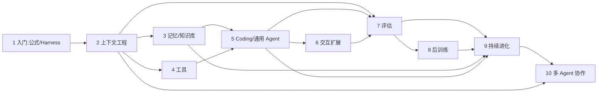
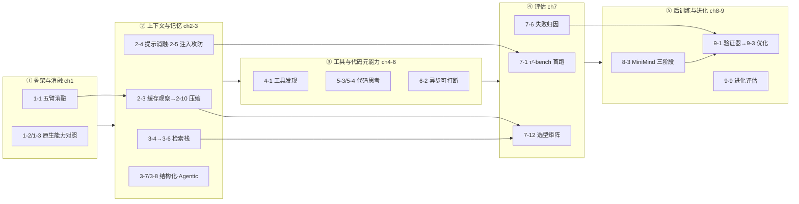

# 《深入理解 AI Agent》全书评估：大纲、逻辑与学习路径

> 评估对象：[bojieli/ai-agent-book](https://github.com/bojieli/ai-agent-book) v2.0，评估基线为本 fork `4aba4f7`（2026-10-26）。
> 定位：「四合一 + 速通」——全书大纲（十章逐章详解）、章间逻辑、学习路径（含技术人员最短路径）、实验体系（含串联导图）。**逐实验一行的明细见同目录《[实验明细总表](AI-Agent-Book-实验明细总表.md)》**。

## 一、全书概览

**《深入理解 AI Agent：设计原理与工程实践》**（李博杰，约 55.7k Star，Apache-2.0）以一条公式贯穿十章：**Agent = LLM + 上下文 + 工具**（LLM 是大脑、上下文是眼睛、工具是手脚）；进入生产环境后改写为 **Agent = Model + Harness**，其中 Harness = 上下文管理 + 工具接口 + 约束 + 验证 + 纠正——后三项正是「能跑的 Demo」与「可靠产品」之间的差距，**遇到问题先查 Harness、再考虑换模型**，这是全书最重要的工程判断。

全书体量：10 章正文约 7300 行 Markdown（`book/` 中文原版为权威源，14 种语言为社区翻译），配套 **109 个编号实验**（ch1–8 共 94 项入各章 `EXPERIMENT_LEDGER.md` 台账；ch9 为 9 个编号实验映射 10 个项目目录，ch10 为 6 个编号实验映射 8 个项目目录），正文刻意不绑定任何 SDK，保证知识不随框架换代过时。

一句话评价：中文世界目前**体系最完整、工程可信度最高**的 Agent 教材——不教你搭能跑的 Demo，而是回答「为什么 Demo 到真实任务就翻车」，并用 Harness 工程给出可靠化路径。

- **突出优势**：① 框架统一观点先行，十章皆可映射回公式；② 实践在前、命名在后，Skill 与 KV-Cache 友好设计源自 Pine AI 真实低容错业务；③ 实验有证据链——manifest 哈希、脱敏回执、负结果照常入账（如 5-3/5-4 假设被推翻仍如实记录）；④ 评估独立成章，Pass@k 与 Pass^k、LLM-as-a-Judge、失败归因均为生产级内容。
- **注意**：不是 SDK 教程（重心在架构与设计原则，实验代码可由 coding agent 生成）；部分实验有 API 成本与 GPU 门槛；翻译版滞后于中文 v2.0；第 8 章是全书唯一需要机器学习基础的一章；少量实验依赖外部仓库锁定版本。

## 二、全文大纲（十章详解）

> 排版约定：先看速查表建立全局，再读逐章详解。每章按 **核心问题 → 内容主线 → 实验与启示** 三层展开；「内容主线」的缩进对应原书节级结构，可当精读目录用。每章均以「本章小结 + 思考题」收束。

### 十章速查表

| 章 | 主题 | 一句话核心 | 实验 | 难度 |
|:--:|---|---|:--:|:--:|
| 1 | AI Agent 入门 | 公式立纲；Harness 是模型之外的竞争力 | 4 | 🟢 |
| 2 | 上下文工程 | 上下文决定能力上限；前缀越稳缓存越准 | 10 | 🔵 |
| 3 | 用户记忆和知识库 | 上下文从单次会话延伸为跨会话持久知识 | 12 | 🔵 |
| 4 | 工具 | 感知控信息量，执行控风险；工具应通用化 | 5 | 🔵 |
| 5 | Coding Agent 与通用 Agent | 代码是运行时创造新工具的元能力 | 16 | 🟣 |
| 6 | 交互：观察与动作空间的扩展 | 模态 × 时序扩展共享同一批系统原语 | 14 | 🟣 |
| 7 | Agent 的评估 | 没有评估，分不清提升与波动；Pass@k vs Pass^k | 14 | 🟡 |
| 8 | 模型后训练 | SFT 记忆、RL 泛化；数据与环境比算法更重要 | 19 | 🔴 |
| 9 | Agent 的持续进化 | 经验沉淀为知识/指令/程序/参数四种载体 | 9 | 🟠 |
| 10 | 多 Agent 协作 | 协作引入新信息才有价值；六种失败模式 | 6 | 🟠 |

难度分级：🟢 入门 ｜ 🔵 进阶 ｜ 🟣 高级 ｜ 🟡 工程级 ｜ 🔴 专家级（需 ML 基础与 GPU）｜ 🟠 应用级。

### 第 1 章 AI Agent 入门 —— 立公式、立方法 🟢

**核心问题**：Agent 到底是什么，什么决定它的能力强弱。本章从观察空间与动作空间这对接口出发，逐一解剖三要素——LLM（大脑）提供理解、推理与决策，上下文（眼睛）决定每个决策点能看到的信息，工具（手脚）决定能对世界做什么改动；学术层对应强化学习的策略（Policy）、观察空间与动作空间。随后给出全书总纲 Harness 五要素（上下文供给、工具接口、约束、验证、纠正），并完成「从提示工程到 Loop 工程」的范式演进叙事。

**内容主线**：
- 公式三层理解：三要素解剖与学术对应；ReAct 循环（推理-行动交替的最小 Agent 形态）。
- Harness 工程：构建有效 Agent 的核心原则；模型选择；编排光谱（链式/路由/并行/编排者-评估者等工作流 → 自主 Agent）；护栏与安全；Harness 五要素与「构建篇」章节的对应。
- 贯穿全书的设计模式（伏笔清单）。

**实验与启示**：1-1~1-4。1-1 五臂上下文消融是全书门面——逐臂拿掉工具定义/工具结果/历史推理/历史观测，看系统如何退化（官方 Starter：`context`）。读完应能回答「Demo 和产品的差距在 Harness 不在模型」，并在自己的项目里指出五要素各对应哪些代码；编排判断标准——任务路径可枚举用工作流，开放探索才用自主 Agent。

### 第 2 章 上下文工程 —— 一次任务内「看到什么」 🔵

**核心问题**：上下文决定能力上限——模型再强，看不到关键信息就会做错决策。本章从 API 消息结构一路讲到 Token 层缓存机制，是全书信息密度最高的一章，也是后续所有章节的地基。

**内容主线**：
- API 视角：四种消息角色；带工具调用的多轮交互（Agent 核心循环）及其代码实现。
- KV Cache 友好设计：Chat Template；缓存原理与 Prompt Cache 两级缓存；前缀越稳定命中越高，系统提示词与工具定义的顺序直接影响 TTFT 与成本——「缓存即架构约束」；可编辑、可组合的缓存笔记。
- 提示工程：语气与风格；结构化提示；流程驱动 vs 规则堆砌；业务规则细化；Few-shot 适用时机；工具定义设计；提示注入防御（上下文安全的核心威胁）。
- Agent Skills：领域能力拆成按需加载的知识包（渐进式披露），解决提示词膨胀；编写方法；上下文位置；与工具的关系。
- Agent 状态栏：用时间戳、工具计数、TODO、错误面板等元信息增强轨迹管理；两种实现与缓存代价。
- 上下文压缩：核心洞察——上下文学习是检索而非推理，压缩要保住任务必需的事实；生产级分层压缩；隔离优于压缩（子 Agent 上下文隔离）。

**实验与启示**：2-1~2-10（观测→缓存→提示→注入→Skill→状态栏→压缩的完整谱系）。2-3 用真实服务记录六种上下文设计的缓存命中差异；2-5 完成 3 攻击通道 × 4 层防御的完整攻防。KV Cache 感知提示架构、渐进式披露、压缩与缓存互补，均为 2025–2026 工业界与学术界共同前沿。

### 第 3 章 用户记忆和知识库 —— 跨会话「记住什么」 🔵

**核心问题**：如何让 Agent 在对话结束后仍记住用户、接入外部知识——把上下文从单次会话延伸为跨会话的持久知识体系。用户记忆（个体尺度）与知识库（群体尺度）共用向量检索、知识压缩等底层技术，面临同样的信息冲突、知识过期与检索不准问题。

**内容主线**：
- 用户记忆系统：三层次评估框架（LoCoMo 基准，平均 300 轮超长对话）；记忆层次结构与四种渐进式存储格式；进阶形态（可执行代码作为记忆载体）；认知科学基础；框架案例；压缩与整理；隐私保护（日志脱敏）。
- RAG 基础：分块 → 稠密嵌入 → 稀疏检索（BM25）→ 混合检索。
- 超越扁平文本：RAPTOR/GraphRAG 结构化索引；文件系统范式（用目录结构组织知识）；知识更新策略。
- Agentic RAG（把检索工具化的范式转变）；上下文感知检索（解决检索块丢上下文）；从检索到知识发现；多模态记忆前沿。

**实验与启示**：3-1~3-12（记忆评估 → 检索栈三级 → 结构化索引 → Agentic → 上下文感知）。`user-memory` 是带后台异步提取与 LoCoMo 评测的完整实现，可直接改造接入业务。记忆系统的三层次评估、冲突解决与时间感知是当前 Agent 产品差异化的主战场。

### 第 4 章 工具 —— 「能做什么」 🔵

**核心问题**：工具是 Agent 的双手，如何分类、设计、组织，以及工具太多时怎么办——工具设计的水平直接决定动作空间的质量。

**内容主线**：工具五分类（感知/执行/协作/事件触发/用户沟通）；通用设计原则——专用工具、通用执行器与 Skill 的能力表达谱系、工具描述的艺术、参数传递的保真性；工具生态（MCP 标准化接入与 Skill Hub）；工具太多时的层次化组织、按需加载与模型原生的主动工具发现；感知工具（控信息量，含多模态感知）；执行工具（控风险：参数校验、权限控制、LLM 二级审批、长输出处理）；协作工具。

**实验与启示**：4-1~4-5。4-1 主动工具发现本地可跑（127 个工具 schema）；4-2/4-4/4-5 因外部凭据 blocked（读台账判读即可）。`execution-tools` 是带完整安全机制的执行工具 MCP Server——输入验证、不可逆操作审批、自动语法校验反馈、超万字符输出自动总结，可直接接到 Claude Code 等运行时复用。口诀：**感知工具控信息量，执行工具控风险；工具设计应通用化，接口设计决定模型行为**。

### 第 5 章 Coding Agent 与通用 Agent —— 创造工具的元能力 🟣

**核心问题**：为什么 Coding 能力是通用 Agent 的基础，代码为什么是「能创造新工具的工具」。本章实验数量冠绝全书（16 项），因为它是官方推荐终极项目（自研 Coding Agent）的主参考。

**内容主线**：
- Coding Agent：Coding 为何是基础能力；案例研究——从 Manus 到 OpenClaw 的通用内核；整体流程；Harness 实践与故障/错误恢复；实现技巧；搜索工具与文件编辑工具；安全。
- 代码元能力六方向：代码作为思考工具（用执行结果验证逻辑，而非「读数据猜结论」）；作为业务规则约束；驱动多媒体生成；作为系统适配器；生成式 UI；代码创造代码的自举。

**实验与启示**：5-1~5-16，多为本地可跑的工程实验；5-3/5-4 是「假设被推翻仍如实入账」的台账范例。面向开放任务的 Agent 无法预置所有工具，运行时自造工具（写脚本、存文件）是灵活性来源，但必须由权限控制、执行隔离与结果验证兜底。

### 第 6 章 交互：观察与动作空间的扩展 —— 走出文本框 🟣

**核心问题**：把观察与动作空间沿「模态 × 时序」两个维度扩展——从异步消息到语音、Computer Use、机器人操作；四类交互共享同一批系统原语：唤醒、安全点、取消、抢占、快慢路径分离。

**内容主线**：
- 异步与事件驱动：为什么需要异步（世界主动找上门）；OpenClaw 事件机制（事件触发工具/用户沟通工具/虚拟身份与隔离执行/事件处理）；不支持原生异步时的兼容方案；GPT-6 Astra 式模型原生异步；从「能收消息」到「可靠处理异步任务」。
- 语音：交互时序从级联流水线到端到端全模态再到全双工；认知时序——实时交互与深度思考的矛盾；更像人的语音合成。
- Computer Use：动作空间设计；视觉定位（Grounding）；世界模型；移动端生态壁垒。
- 机器人：XLeRobot 整理桌面案例——硬件与算法分工、长程规划、VLA 控制及其局限、世界模型、仿真到实机。

**实验与启示**：6-1~6-14（异步 3 项、语音 4 项、Computer Use 2 项、机器人 5 项；6-1 blocked，6-2/6-3 passed）。全双工的「实时响应 vs 深度思考」权衡、GUI 视觉定位、VLA 局限与世界模型补偿，是 Agent 与物理世界打通的前沿。

### 第 7 章 Agent 的评估 —— 把表现变成可信信号 🟡

**核心问题**：没有评估，就分不清「设计带来的提升」和「随机波动」——这是全书反复捶打的地基。本章以 τ²-bench telecom 领域为解剖样本，把一次评估任务拆到器官级。

**内容主线**：一条评估任务的解剖（任务定义四要素 + 真实轨迹）；评估指标——Pass@k 看能力上限，**Pass^k 看业务可靠性**（k 个环节全过才算成的业务视角）；评估环境五要素（人机交互型 vs 工具调用型）；数据集设计（基准横向对照、验证器、难度划分、数据泄漏防范、质量控制、三个来源）；自动化评估——LLM-as-a-Judge、失败归因（从整条轨迹定位首个错误）、端到端回归 vs 轨迹前缀回归、配对比较与模型排名；评估驱动的模型选型（行为策略、成本分析）；统计显著性；可观测性；从 Benchmark 报告到系统改进（数据 → 假设 → 路线图）；生产级内部评估（消融基础设施、AB 测试、双层特性开关、提示敏感性）；仿真环境（保真度与领域随机化）——通向后训练的桥梁。

**实验与启示**：7-1~7-14（含人肉基准 7-2、Elo 排行 7-8、选型矩阵 7-12 等分析型实验）。给自己的 Agent 先建一个十几条任务的小评估集再谈优化；每次只改一个变量；评估对象是整个系统——上下文、工具、验证机制变了同样要测。

### 第 8 章 模型后训练 —— 把能力写入参数 🔴

**核心问题**：能力如何内化进模型参数——预训练 / Mid-training / SFT / RL 四阶段各自在做什么，何时选 SFT、何时选 RL。本章纲目：**SFT 记忆，RL 泛化；数据与环境比算法更重要**。全书唯一需要 ML 基础与 CUDA GPU（Python 3.12+，依赖经 `--extra vllm` / `--extra unsloth` 安装）。

**内容主线**：四阶段全景（SFT 本质是换了数据的「预测下一个词」；何时先补底座）；经典 RL Agent 到现代 Agent 的动作表示演变与预训练基础（`[可选阅读]`）；Mid-training 补知识与基础能力；SFT 数据合成（从示范到可训练轨迹）；何时选择 Mid-training / SFT / RL；单轮强化学习——记忆与泛化的对照；RL 算法（16 次 rollout 到一次参数更新；为什么 LLM RL 优先 On-Policy）；RL 环境——从评估到仿真（造不出环境就让模型扮演；环境、任务分布与评估隔离）；多轮任务与信用分配；工具调用把环境带进 Agent；奖励设计（来源/时机/表达力/RLVP 路径约束）；蒸馏（在轨蒸馏让一次 rollout 产生密集监督；On-Policy 自蒸馏）；三个真实问题案例（Coding Agent 过早结束、中文引号、编辑文件失败）到后训练的闭环。

**实验与启示**：8-1~8-19；8-11~8-16 为外部复现轨道（锁定 commit 的第三方基准，需 H100 级，标注 not run）；8-17/8-18/8-19 案例线用确定性数据、成本低。后训练是把评估发现的问题固化为模型能力的通路。

### 第 9 章 Agent 的持续进化 —— 全书汇合点 🟠

**核心问题**：部署不是终点——如何从运行轨迹中获得学习信号，让 Agent 越用越强；经验沉淀到哪：**知识 / 指令 / 程序 / 参数**四种更新载体。

**内容主线**：从运行轨迹获得学习信号（环境结果 / 过程规则 / LLM Rubric）；四种方法——沉淀为知识（RAG 更新）、写成指令（提示词自优化）、写成程序（工具与代码自演化）、写入参数（连接后训练）；从更新产物到更新「更新方法」本身；可长期运行的持续进化闭环——可验证闭环的边界（当「完成」不等于「进步」）；安全边界；睡眠学习（整合、遗忘与能力保鲜）。

**实验与启示**：9-1~9-9 共 9 个编号实验，映射 10 个项目目录；推荐主线 trajectory-verifier → prompt-auto-optimization → self-evolution-eval。更新载体的选择取决于能力如何被表达与验证——能被规则验证的写成程序，只能被 LLM 判断的沉淀为知识/指令，量变到质变才动参数；灰度与回滚机制是进化闭环的安全网。

### 第 10 章 多 Agent 协作 —— 重新组织上下文、工具与责任 🟠

**核心问题**：群体智能何时真正高于个体。本章给出**新信息判据**——只有当协作引入了单个 Agent 在生成时拿不到的新信息（审核 Agent 真正跑了测试、读了日志、看了截图），协作才产生价值；多 Agent 的每个设计决策都能在单 Agent 三要素中找到对应。

**内容主线**：分类框架（上下文共享/独立 × 对等/管理者/去中心化拓扑）；共享上下文的协作；不共享上下文的协作（Agent 眼中的文件系统、通信与控制）；三种拓扑详解（对等：相互制衡与迭代改进；管理者：中心化协调；去中心化）；跨组织协作 A2A 协议；六种失败模式（共享文件系统并发冲突、错误级联放大、同质趋同、互相扯皮、循环失控、理解债与认知投降）；Agent 社会（斯坦福 AI 小镇、Agentopia 十年尺度生活模拟、Moltbook 社交网络、Vending-Bench Arena 经济竞争、Pinchwork/RentAHuman Agent 经济、狼人杀信息不对称博弈）。

**实验与启示**：10-1~10-6 共 6 个编号实验，映射 8 个项目目录；`book-translation` 的多语言流水线本身就是多 Agent 项目——本书 14 种语言版本即其产出。搭多 Agent 前先过三问：任务真需要分工吗？不同 Agent 能拿到不同信息吗？协作收益盖得住 Token、通信与调试成本吗？六种失败模式是现成的架构评审清单。

**后记**回扣公式，提出 Agent 天空的「两朵乌云」（实时流式交互、从交互中持续学习）与模型-Harness 飞轮：模型一层层吃掉 Harness，但永远吃不完。

## 三、各章逻辑关系

### 3.1 一条公式 → 三大板块

第 1 章立公式，此后沿 **构建（2–6）→ 评估与进化（7–9）→ 协作（10）** 展开：ch2 管「一次任务内看到什么」，ch3 扩展到「跨会话记住什么」，ch4 定义「能做什么」，ch5 给出「创造新工具的元能力」，ch6 把观察与动作空间推向语音/GUI/物理世界；ch7 把表现变成可信信号，ch8 把能力写入参数，ch9 让系统长期变好，ch10 重新组织上下文、工具与责任。后记点明 **第 9 章是全书汇合点**——没有轨迹与知识（3）、代码能力（5）、评估（7），经验就无处保存、无法落地、无法判断进退。

### 3.2 贯穿全书的三条暗线与一个飞轮

- **上下文成本线**：ch2 的 KV Cache 约束 → ch3 检索注入取舍 → ch7 成本分解与压缩 A/B（7-10、7-12）→ ch8 训练侧视角。读懂它，就明白「缓存即架构约束」为何是设计而非优化。
- **代码元能力线**：ch5「代码作为思考工具/系统适配器」→ ch9 self-modifying-agent（Agent 修改自己的工具与 Harness）→ ch10 Agent 间经文件系统与代码协作。
- **评估闭环线**：ch7 Pass^k 与失败归因 → ch8「环境：模型练习的场地」（评估环境即 RL 环境）→ ch9 可验证闭环（有来源、独立验证、可回滚）→ ch10 多 Agent 失败模式归因。
- **模型-Harness 飞轮**（后记）：Harness 里每段兜底逻辑都标记着模型此刻做不稳的地方；模型内化一层，Harness 就向新前沿迁移一层。这解释了全书为何「观点先行」——Harness 的杠杆今天最大，但护城河要建在技术之外。

### 3.3 阅读顺序弹性

严格顺序 1→10 可行；ch3/ch4 可在 ch2 后并行；ch6 相对独立可后置；ch8 的 `[可选阅读]` 小节非 ML 背景可跳过（只读四阶段全景与案例节）；ch9/10 依赖前文概念但无代码依赖。每章末思考题（配 `book/reference-answers.md` 参考答案）是检验「真读懂」的最快工具。

## 四、学习路径

### 4.1 环境准备（本仓库已有资产，直接复用）

- **本地后端**：`docs/setup/`——`select_backend.sh`（探测/切换 Ollama/vLLM 写入 `.env` 受管块）、`verify_all.sh`（问答级 + 工具调用级两层验收）、`serve_vllm_wsl.sh`（vLLM 参数内置 tool-call-parser 等实验必需项）。
- **GPU 服务器**：`gpu_server.sh` 六子命令（check/kimi/serve/probe/keycheck/five）覆盖阶段 0→2，Moonshot 免费档已内置 ≤3 req/min 客户端节流。
- **验证文化**：`docs/experiments/EXPERIMENT_CONVENTIONS.md` + `verify_chapter1_experiments.py`（28 项机器复核）。跑实验前先读它，证据落盘姿势全书统一。
- **官方 Starter 清单**（每章第一个该跑的）：ch1 `context`、ch2 `context-compression`、ch3 `user-memory`、ch4 `execution-tools`、ch5 `coding-agent`、ch6 `live-audio`、ch7 `tau2-bench-eval`、ch8 `cot-distillation`、ch9 `trajectory-verifier`、ch10 `parallel-web-research`。

### 4.2 三条路径（详解）

#### 路径 A · 应用工程师最小路径（4–6 周）

- **适合**：要把 Agent 用于真实业务、首要诉求是「可靠」的应用工程师；不追求训练模型。
- **目标**：把一个真实任务 Agent 化，并建成 Pass^k 口径的评估集——这是「能跑」到「敢上线」的分界线。
- **为什么是这条线**：应用可靠性的瓶颈几乎总在上下文与评估，而非模型或训练——所以跳过 ch3 细节与 ch5/6/8/9，把时间集中在 ch2 与 ch7。
- **阶段拆解**：
  1. 第 1 周：ch1 精读 + 实验 1-1（用消融理解组件贡献）；按 4.1 搭好本地后端。
  2. 第 2–3 周：ch2 全章 + 2-4（提示消融）、2-5（注入攻防）、2-10（压缩）——把上下文管好。
  3. 第 4 周：ch4 工具设计原则 + 4-1（检查自己的工具面是否过载）。
  4. 第 5–6 周：ch7 + 7-1（τ²-bench 首跑）→ 把自己的任务改造成带验证器的评估集。
- **验收**：一个能跑的真实任务 Agent + 一份 Pass^k 报告 + 一次注入防御演练记录。

#### 路径 B · 完整实践路径（3–4 个月）

- **适合**：要系统掌握全书、愿意逐章打卡的学习者；时间充裕的学生或转型者。
- **节奏**：约每章 1.5–2 周——精读 → 按《实验明细总表》挑 2–4 个实验 → 台账自评 → 一篇判读短文。
- **实验挑选**：ch3 按 3-4→3-5→3-6 搭检索栈；ch5 推荐 5-1/5-2（故障切换）、5-6（论文转 PPT）、5-13（ERP）；ch6 选 6-2（异步）+ 6-9（browser-use）；ch7 选 7-1/7-6；ch8 选 8-3（MiniMind 三阶段）、8-17（DPO 案例）；ch9 按 9-1→9-3→9-9；ch10 选 10-2（翻译）。
- **红线**：blocked 实验不得用本地桩冒充完成；负结果照常入账。
- **验收**：`EXPERIMENT_LEDGER` 状态列自评 + 每月一篇判读文档入 `docs/experiments/`。

#### 路径 C · 后训练/研究方向（2–3 个月）

- **适合**：有 GPU（≥24GB 显存更佳）与 ML 基础，关心「能力从哪来」的研究者。
- **逻辑**：先建立评估观（ch7 先行——评估环境即 RL 环境），再进 ch8，最后接 ch9 自进化。
- **阶段拆解**：
  1. 第 1–2 周：ch7 精读 + 7-1/7-10（会算成本）。
  2. 第 3–6 周：8-1/8-2（Q-learning 对照，复用 ch1 环境）→ 8-3 MiniMind 100M 三阶段 → 8-4/8-5 选做。
  3. 第 7–8 周：8-8/8-9 蒸馏线 → 8-17/8-18/8-19 案例线（确定性数据，成本低）。
  4. 第 9–12 周：8-11~8-16 外部复现（量力，H100 级）→ ch9 自进化项目。
- **验收**：复现一份带 manifest 哈希链的训练报告（8-3 或 8-17 均可）。

**终极实践主线**（官方 FAQ 推荐）：从头做一个类似 Claude Code 的 Coding Agent——ch1–5 支撑可用版本，ch7/9 为它建评估集并持续改进，ch8 介入模型本身，ch6/10 扩展交互与协作。三条路径都可以汇入这条主线。

### 4.3 技术人员最短路径（5–7 天速通）

前提：会 Python、用过 LLM API。目标是建立「公式 → Harness → 评估 → 进化」的主干认知，**实验只跑四个锚点**（1-1 / 2-3 / 2-5 / 7-1），其余用台账判读替代动手——台账的判读文本本身就是高质量教材。

| 天 | 读 | 跑/做 | 自检标准 |
|---|---|---|---|
| D1 | ch1 全章（含编排光谱与护栏） | 1-1 五臂消融（harness 已就绪） | 能解释「为什么拿掉工具结果会盲目执行」 |
| D2 | ch2 四节：API 上下文结构 / KV Cache / 提示注入 / 压缩 | 2-3 + 2-5 | 能指出自己项目里破坏缓存前缀的写法 |
| D3 | ch4 工具设计原则；ch5「代码作为思考工具/系统适配器」 | 读 5-3/5-4 台账判读 | 能说出专用工具 vs 代码执行器的取舍 |
| D4 | ch7：Pass@k vs Pass^k / 评估环境五要素 / 失败归因 | 7-1 首跑 | 给自己的任务写出 Pass^k 口径 |
| D5 | ch8：四阶段全景 +「何时选哪条」+ 三案例（跳过可选节） | — | 能判断自己的问题该 SFT、RL 还是不训 |
| D6–7 | ch9 四种沉淀方法；ch10 六种失败模式 | — | 画出自己系统的进化闭环草图 |

**极简三日读版**（不跑实验，先建 vocabulary 再决定投入）：D1 ch1；D2 ch2 + ch7 指标两节；D3 ch9 + ch10 失败模式节。
**选做原则**：测量类实验（便宜、证据可复用）先于对照类，对照类先于训练类；blocked 项读台账判读即可获得八成价值。

### 4.4 与当前进度的衔接

实验 1-1 已推进到 GPU 服务器阶段 2：keycheck 通过、full 臂两连 correct、主动节流补丁已推送，待重跑 `five` 完成云端对照。下一步：① 五臂 accepted 后填对照表并跑 `verify_chapter1_experiments.py`；② 做 1-2（web-search-agent）；③ 进入 ch2——2-3（KV Cache 反模式）与 2-10（六种压缩）是 1-1 的直接延伸：1-1 回答「拿掉会怎样」，2-x 回答「塞满怎么办」。

## 五、实验体系

### 5.1 台账文化（先读再用）

各章 `EXPERIMENT_LEDGER.md` 是练习的权威索引，也是本项目区别于一般教程的杀手锏：每个实验一行验收记录——冻结的验收门槛、状态、规范证据路径（manifest 哈希 + 原始日志），失败结果也保留为证据。三条规则：**中文手稿是验收源**，实验设计照手稿门栏执行；**passed ≠ 假设成立**——统计上的负结果仍是完整实验（如 5-3/5-4 假设被推翻，均如实入账）；**blocked ≠ 失败**——凭据/配额等外部原因在推理前阻断不折算为模型失败，也不得以本地代理冒充完成。每次运行留 `validation/latest.json` + manifest SHA-256，可独立复核。这种科学诚实值得直接搬进自己的项目。

**无云端凭据/受限网络下的替代方法**（红线兼容）：替代的前提是保住「真实性」——真实服务、真实推理、真实数据，只是换了提供方；被禁止的只是用桩伪造行为。三条路径：① **LLM/嵌入/重排后端 → 本地或免费源**：LLM 换 Ollama/vLLM 本地推理（先例：4-1 canonical 即用本地 qwen3:4b 完成），嵌入/重排换开源模型（先例：7-12 用 Qwen3-Embedding-8B 替代端点受限的 Doubao，照常入账）；② **外部 SaaS 凭据 → 自托管真实服务或免费层**：搜索用自托管 SearXNG，邮件/日历用自托管 SMTP/CalDAV，协作通道用自托管 Matrix 与 SMTP 真发（逐项速查见《实验明细总表》附录「blocked 项替代路径速查」）；③ **硬件级受限 → 云租或降规模**：H100 级复现可按时租卡，或缩小模型/数据做「方法学演练」——后者不是原实验完成，需如实标注。判定规则：替代后仍满足原验收门槛 → 正常入账并在环境栏注明替换（官方先例：2-6 在 Anthropic 凭据受阻后改用 Kimi Code CLI 通过）；不满足 → 不得标 passed，记「降级复现/部分复现」。

### 5.2 分章汇总（逐实验明细见附录）

| 章 | 编号实验 | 台账状态总览 | 门槛与技术栈 |
|---|---|---|---|
| 1 | 4 | 3✅ 1✅* | 云端 API（Kimi/OpenAI/DashScope）；1-1 可本地 Ollama 替代 |
| 2 | 10 | 9✅ 1📝 | 本地 ~0.6B 小模型 + 云端对照；可视化与 Skill 工具链 |
| 3 | 12 | 台账未单列 | 本地嵌入/BM25/重排 + 云端 LLM；CAIL2018 等公开数据 |
| 4 | 5 | 2✅ 3⛔ | MCP 服务器 + 多模态；blocked 项需外部凭据 |
| 5 | 16 | 15✅ 1📦 | 本地工程实验为主（Blender/PostgreSQL/浏览器等） |
| 6 | 14 | 2✅ 1⛔ 余未单列 | 异步子进程/语音模型/Computer Use/XLeRobot（真机可选） |
| 7 | 14 | 1◐ 余未单列 | 评估方法学；τ²-bench/AndroidWorld/Arena 数据 + 分析型 |
| 8 | 19 | 12✅ 1— 6⏹ | GPU 训练（RTX PRO 6000 级）+ 6 项外部复现（H100 级，not run） |
| 9 | 9（10 目录） | 未入台账 | 轻量工程为主，本地可跑 |
| 10 | 6（8 目录） | 未入台账 | 模拟/复现/外部项目 |

\* 1-3 官方 OpenAI 路径配额受阻，DashScope 等价托管路径已通过。图例与逐实验说明见《实验明细总表》。

**选做门槛从低到高**：ch9/ch2 本地项 → ch1/ch3 云端项 → ch5 工程项 → ch7 分析项 → ch8 GPU 项；blocked 的 4-2/4-4/4-5/6-1 需先解决外部凭据（免云端替代路径见 5.1 节与附录速查），勿用本地桩冒充完成（台账红线）。

**GPU 需求评估（按训练类型，基准：RTX 5080 16GB）**：

| 训练类型 | 代表实验 | 显存量级 | 16GB 判定 |
|---|---|---|---|
| 无训练（推理/观测/消融/评估） | ch1–7 全部；8-17~8-19 评估侧 | 9B Q4 ≈ 6GB；7B bf16 ≈ 15GB | ✅ 可行 |
| 经典表格 RL | 8-1/8-2 | 忽略不计（CPU 亦可） | ✅ 轻松 |
| 小模型全参（0.1B 级预训练/SFT/VLM） | 8-3/8-4/8-5 | 100M 全参（AdamW）≈ 数 GB；历史用 RTX 4090 | ✅ 轻松 |
| 蒸馏（学生 0.1–1.5B） | 8-8/8-9 | 学生侧 <10GB；教师可云端批量生成后离线训练 | ✅ 可行 |
| LoRA/QLoRA 微调（3–8B） | 8-6/8-17/8-18/8-19 | QLoRA 7–8B ≈ 10–14GB（DPO 含参考模型取上限） | ✅ 需 4-bit 基座 + 小 batch |
| 20B 级 SFT | 8-7 | QLoRA ≈ 14GB 边缘；全参需多卡 | ⚠️ 极限，建议云 |
| 在线 RL（rollout 引擎+训练共存） | 8-13~8-16 | ≤4B + LoRA 才可能挤进 16GB；7B+ 需 24–96GB | ⚠️ 仅方法学演练 |
| 大规模 RL/后训练 | 8-10（8×H100 80GB） | 多卡 H100 级 | ❌ 仅云租 |

降规模三板斧：**QLoRA**（4-bit 基座挂 LoRA；ch8 正文把 LoRA 定为「所有后训练方法的工程默认项」，SFT 用 rank 64–256、RL 用 8–32）、**缩模型**（1.5B/4B 替代 7–8B，结论方向可复验但强度需如实降档）、**缩数据与 batch**（gradient checkpointing + 梯度累积）。云阶梯：Colab/Kaggle 免费档（16GB 级）→ 按时租 24GB 卡 → A100/H100。注意：8-18/8-19 官方用 8B bf16（仅权重就约 16GB），16GB 卡必须转 QLoRA 并在台账注明偏差。

### 5.3 把 109 个实验串成一条线

**一条主线**：109 个实验都在对公式的某个组件做五种动作之一——**拆**（消融）、**测**（观测）、**扩**（记忆/模态/工具）、**评**（评估）、**改**（训练与进化）；串起来即「先拆解、再补全、后进化」。

**三个环**（比线性顺序更本质的连接）：
1. **方法学环（拆→评）**：1-1 手工消融 → 2-4 提示消融 → 7-1 系统化评估——同一个「控制变量」思想的三次升级。
2. **证据环（评→改）**：7-6 失败归因 → 9-1 轨迹验证器 → 9-3 Prompt 自动优化 → 9-9 进化评估——失败轨迹成为改进燃料。
3. **内化环（改→参数）**：5-3/5-4 代码外挂思考 → 8-14 ReTool 训练工具使用 → 9-x 经验写入参数——从 Harness 兜底到模型内化，即后记飞轮的具体化。

**选做原则**：测量类（1-1/2-3/7-1）→ 对照类（2-4/2-10/3-6）→ 训练类（8-x）；ch9/ch10 按「验证器→优化→评估」「对照→模拟→博弈」各自成线。另一个串联视角是官方终极项目：把 109 个实验看作「自研 Coding Agent」的备件库——每个实验为它提供一只组件或一项测试。

### 5.4 两种消融速查：手工消融（1-1）与提示消融（2-4）

两者是同一方法学（控制变量）在两个粒度上的应用，也是 5.3 节「方法学环」的前两站。

**手工消融（1-1 五臂）——架构层**
- 目的：量化每个信息通道对能力的贡献，回答「拿掉它会怎样」，为 Harness 五要素建立组件级因果直觉；线上故障排查时，消融臂的行为就是对照模板。
- 方法：固定任务、模型、验收不变，逐臂只剥一个通道——full 基线 / no_history（只留 system + 最后一条 user）/ no_reasoning（剥历史思考字段）/ no_tool_calls（不声明工具 schema）/ no_tool_results（工具结果置空）；实现上就是五个上下文模式开关，同一任务跑完后对判据比较。
- 判读：**失败方式比失败本身更有信息量**——无工具结果 → 盲目执行并编造数字；无历史推理 → 逐字重复同一动作。这些「预言行为」是定位线上 Agent 故障的特征指纹。

**提示消融（2-4）——词句层**
- 目的：验证提示词每个成分的边际价值（语气/结构/规则块/few-shot），防止「提示词 Cargo Cult」（不加证据地堆提示），同时为 KV Cache 成本做减法。
- 方法：固定模型、工具、任务与评估集，对提示做**单变量**修改（删一条规则、去 few-shot、换组织结构），A/B 对照跑同批任务；判读三件套：任务质量变化 + token 成本 + 缓存命中率（前缀稳定性）。

共同纪律：**先跑基线；一次只改一个变量；改前写预测、改后对照**——预测落空处就是认知增量所在。7-1 把这两个粒度统一进系统化评估（指标/数据集/显著性），构成方法学环的三级阶梯。

## 六、文档地图与维护

| 文档 | 分工 |
|---|---|
| 本文 | 四合一速览：大纲/逻辑/路径/实验汇总与串联导图 |
| 《实验明细总表》（同目录） | 109 个编号实验逐项一行：名称/技术栈/说明/台账状态 + blocked 项替代路径速查 |
| `2026-10-24-项目结构与十章详解.md` | 仓库三层资产结构与十章逐节深读、九条研究方向 |
| `2026-10-24-全书主线与学习实践计划.md` | 五条主线自查清单与六阶段路线 |
| `2026-10-25-阶段一精读计划执行步骤.md` | 第 1 周逐日执行卡（含 1-1 操作步骤） |
| `ai-agent-book-评估与实践指南.md` | 项目评估、技术架构、三条利用路径 |

维护约定：上游书稿演进时，本文第二、五节与《实验明细总表》需对账（章标题、实验编号与状态以 `book/` 与各章 ledger 为准）；学习路径部分随 `docs/experiments/` 判读进展滚动更新。
