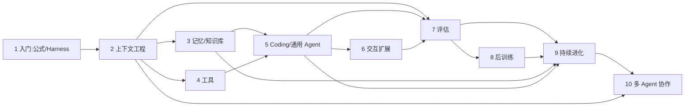

# 《深入理解 AI Agent》全书评估：大纲、逻辑与学习路径

> 评估对象：[bojieli/ai-agent-book](https://github.com/bojieli/ai-agent-book) v2.0，评估基线为本 fork `a8fad8c8`（2026-10-25）。
> 定位：一份自足的「四合一」速览——全文大纲、章间逻辑、学习路径、练习实践。深读另见 `docs/guide/` 既有四篇（文末「文档地图」）。

## 一、全书概览

**《深入理解 AI Agent：设计原理与工程实践》**（李博杰，约 55.7k Star，Apache-2.0）以一条公式贯穿十章：**Agent = LLM + 上下文 + 工具**；进入生产环境后改写为 **Agent = Model + Harness**。10 章正文约 7300 行 Markdown（`book/` 中文原版为权威源，14 种语言为社区翻译），配套 **109 个实验**（各章 `EXPERIMENT_LEDGER.md` 台账计 101 项，含本地项目与外部复现轨道），另附课程 slides、站点、共享 `agentbook` 供应商解析包。

一句话评价：中文世界目前**体系最完整、工程可信度最高**的 Agent 教材——它不教你搭能跑的 Demo，而是回答「为什么 Demo 到真实任务就翻车」，并用 Harness 工程给出可靠化路径。

- **突出优势**：① 框架统一观点先行，十章皆可映射回公式；② 「实践在前，命名在后」，Skill、KV-Cache 友好设计等源自 Pine AI 真实低容错业务；③ 实验有证据链——manifest 哈希、原始凭据脱敏回执、负结果照常入账（如 2-5 提示注入全部防御成功也如实记录）；④ 评估独立成章，Pass@k 与 Pass^k 之分、LLM-as-a-Judge、失败归因均为生产级内容。
- **注意**：不是 SDK 教程（重点是架构而非逐行代码）；部分实验有 API 成本与 GPU 门槛；翻译版滞后于中文 v2.0；第 8 章需机器学习基础；少量实验依赖外部仓库锁定版本。

## 二、全文大纲（十章速览）

每章均以「本章小结 + 思考题」收束，形成可打卡的学习闭环。

1. **AI Agent 入门**——建立公式的实现/直觉/学术三层理解：观察空间与动作空间是模型与世界的接口，工具是手脚、LLM 是大脑、上下文是眼睛；ReAct 循环；Harness 工程与「从提示工程到 Loop 工程」的范式演进；构建有效 Agent 的核心原则、模型选择、编排光谱（链式/路由/并行/编排者-评估者等工作流到自主 Agent）、护栏与安全；埋下贯穿全书的设计模式。*实验 1-1~1-4。*
2. **上下文工程**——从 API 视角解剖上下文（四种消息角色、带工具调用的多轮核心循环）；KV Cache 友好设计（Chat Template、两级缓存、「缓存即架构约束」）；提示工程（语气/结构化/流程驱动/Few-shot/工具定义）；提示注入防御；Agent Skills 可组合领域能力；Agent 状态栏；上下文压缩（分层压缩、隔离优于压缩、子 Agent 上下文隔离）。*实验 2-1~2-10。*
3. **用户记忆和知识库**——记忆三层次评估框架、层次结构与四种存储格式（进阶形态：可执行代码）、认知科学基础与压缩整理；RAG 管道（分块、稠密/稀疏/混合检索）；超越扁平文本（RAPTOR/GraphRAG 结构化索引、文件系统范式、知识更新）；Agentic RAG 与上下文感知检索；多模态记忆前沿。*实验 3-1~3-12。*
4. **工具**——工具分类（感知/执行/协作）；设计通用原则（专用工具 vs 通用执行器 vs Skill、工具描述的艺术、参数传递保真）；MCP 与 Skill Hub 生态；工具过多时的层次化组织与模型原生主动工具发现；多模态感知。*实验 4-1~4-5。*
5. **Coding Agent 与通用 Agent**——Coding 是 Agent 的基础能力（从 Manus 到 OpenClaw 的通用内核）；Coding Agent 整体流程、Harness 实践、故障与错误恢复、搜索/文件编辑工具与安全；代码作为通用 Agent 的元能力（思考工具、业务规则约束、多媒体生成、系统适配器、生成式 UI、代码创造代码的自举）。*实验 5-1~5-16。*
6. **交互：观察与动作空间的扩展**——异步与事件驱动（OpenClaw 事件机制、兼容方案、GPT-6 Astra 式模型原生异步）；语音三级范式（级联流水线/端到端全模态/全双工）与认知时序；Computer Use GUI 自动化（动作空间、视觉定位、世界模型、移动端生态）；机器人操作（XLeRobot 案例的规划—VLA 控制—世界模型—仿真到真实）。*实验 6-1~6-3。*
7. **Agent 的评估**——以 τ²-bench telecom 解剖一条评估任务；Pass@k（能力上限）与 Pass^k（业务可靠性）；评估环境五要素与数据集设计（验证器、难度划分、泄漏防范）；LLM-as-a-Judge 与失败归因（定位首个错误、轨迹前缀回归）；评估驱动的模型选型与成本分析、统计显著性、可观测性；生产级内部评估（消融基础设施、AB 测试、特性开关）；仿真环境是通向后训练的桥梁。*实验 7-1~7-14。*
8. **模型后训练**——预训练/Mid-training/SFT/RL 四阶段全景与「何时选哪条」；SFT 数据合成与 RL 算法（从 rollout 到参数更新、On-Policy 优先）；RL 环境（造不出就让模型扮演）；多轮任务信用分配；奖励设计（来源/时机/表达力/RLVP 路径约束）；蒸馏（在轨蒸馏与自蒸馏）；三个真实问题案例到后训练的闭环。*实验 8-1~8-19（含外部复现轨道）。*
9. **Agent 的持续进化**——从运行轨迹中获取学习信号；经验沉淀的四种方法（写成知识/指令/程序/参数）与「更新更新方法」本身；可验证的长期进化闭环、安全边界、睡眠学习（整合、遗忘与能力保鲜）。*项目 10 个，阅读顺序：trajectory-verifier → prompt-auto-optimization → self-evolution-eval。*
10. **多 Agent 协作**——分类框架（上下文是否共享 × 协作拓扑）与「何时多 Agent 真正优于单 Agent」；共享上下文协作；不共享协作（文件系统视图、通信控制、对等制衡/管理者/去中心化、A2A 协议）；六种失败模式（并发冲突、级联放大、同质趋同、扯皮、循环失控、理解债）；Agent 社会前沿（斯坦福 AI 小镇、Agentopia、Moltbook、Vending-Bench、狼人杀博弈）。*项目 8 个。*

**后记**回扣公式，提出 Agent 天空的「两朵乌云」（实时流式交互、从交互中持续学习）与模型-Harness 飞轮：模型一层层吃掉 Harness，但永远吃不完。

## 三、各章逻辑关系

### 3.1 一条公式 → 三大板块

第 1 章立公式，此后沿 **构建（2–6）→ 评估与进化（7–9）→ 协作（10）** 展开：第 2 章管「一次任务内看到什么」（上下文），第 3 章扩展到「跨会话记住什么」（记忆/知识），第 4 章定义「能做什么」（工具），第 5 章给出「创造新工具的元能力」（代码），第 6 章把观察与动作空间推向语音/GUI/物理世界；第 7 章把表现变成可信信号，第 8 章把能力写入参数，第 9 章让系统长期变好；第 10 章重新组织上下文、工具与责任。后记点明：**第 9 章是全书汇合点**——没有轨迹与知识（3）、没有代码能力（5）、没有评估（7），经验就无处保存、无法落地、无法判断进退。

### 3.2 贯穿全书的三条暗线与一个飞轮

- **上下文成本线**：ch2 的 KV Cache 约束 → ch3 的检索注入取舍 → ch7 的成本分解与压缩 A/B（7-10、7-12）→ ch8 的训练侧视角。读懂它，就明白「缓存即架构约束」为何是设计而非优化。
- **代码元能力线**：ch5 的「代码作为思考工具/系统适配器」→ ch9 的 self-modifying-agent（Agent 修改自己的工具与 Harness）→ ch10 的 Agent 间通过文件系统与代码协作。
- **评估闭环线**：ch7 的 Pass^k 与失败归因 → ch8 的「环境：模型练习的场地」（评估环境即 RL 环境）→ ch9 的可验证闭环（每次更新有来源、独立验证、可回滚）→ ch10 对多 Agent 失败模式的归因。
- **模型-Harness 飞轮**（后记）：Harness 里每段兜底逻辑都标记着模型此刻做不稳的地方；模型内化一层，Harness 就向新前沿迁移一层。这解释了全书为何「观点先行」——Harness 的杠杆今天最大，但护城河要建在技术之外。

### 3.3 阅读顺序弹性

严格顺序 1→10 可行；ch3/ch4 可在 ch2 后并行；ch6 相对独立可后置；ch8 标注了 `[可选阅读]` 小节，非 ML 背景可只读四阶段全景与案例节；ch9/10 依赖前文概念但无代码依赖。每章末思考题是检验是否「真读懂」的最快工具。

## 四、学习路径

### 4.1 环境准备（本仓库已有资产，直接复用）

- **本地后端**：`docs/setup/` 工具链——`select_backend.sh`（探测/切换 Ollama/vLLM 并写入 `.env` 受管块）、`verify_all.sh`（两层验收：问答级 + 工具调用级）、`serve_vllm_wsl.sh`（vLLM 参数内置 tool-call-parser 等实验必需项）。
- **GPU 服务器**：`docs/setup/gpu_server.sh` 六子命令（check/kimi/serve/probe/keycheck/five）覆盖练习计划阶段 0→2，Moonshot 免费档已内置 ≤3 req/min 客户端节流。
- **验证文化**：`docs/experiments/EXPERIMENT_CONVENTIONS.md` + `verify_chapter1_experiments.py`（28 项机器复核）。跑实验前先读它，证据落盘姿势全书统一。

### 4.2 三条路径

| 路径 | 适合 | 周期 | 章节与实验 | 验收标准 |
|---|---|---|---|---|
| A · 应用工程师最小路径 | 把 Agent 用于业务，求可靠 | 4–6 周 | ch1→ch2→ch4→ch7；实验 1-1、1-2、2-4、2-5、2-10、7-1 | 把一个真实任务 Agent 化，并建成 Pass^k 口径的评估集 |
| B · 完整实践路径 | 系统掌握全书 | 3–4 个月 | 逐章精读 + 台账实验按 5.2 表挑选；ch3 按 3-4→3-6 顺序预热检索栈；ch5 挑 2–3 个（推荐 5-6/5-10/5-13）；ch8 挑 8-3、8-8、8-17 | `EXPERIMENT_LEDGER` 状态列自评，每月一篇判读文档入 `docs/experiments/` |
| C · 后训练/研究方向 | 有 GPU 与 ML 基础 | 2–3 个月 | ch7 先行（评估即 RL 环境）→ ch8：8-3 MiniMind 100M 三阶段 → 8-8/8-9 蒸馏 → 8-17/8-18/8-19 LoRA 案例线 → ch9 自进化项目 | 复现一份带 manifest 哈希链的训练报告 |

### 4.3 与当前进度的衔接

实验 1-1（五臂上下文消融）已推进到 GPU 服务器阶段 2：keycheck 通过、full 臂两连 correct、RPM 节流补丁已推送，待重跑 `five` 完成云端对照。自然的下一步：① 五臂 accepted 后填对照表并跑 `verify_chapter1_experiments.py`；② 做 1-2（web-search-agent，两级试用第②级）；③ 顺着第 1 章的「上下文是眼睛」进入 ch2，实验 2-3（KV Cache 六场景）与 2-10（六种压缩策略）是 1-1 消融的直接延伸——1-1 回答「拿掉会怎样」，2-x 回答「塞满怎么办」。

## 五、练习与实践总表

### 5.1 台账文化（先读再用）

各章 `EXPERIMENT_LEDGER.md` 是练习的权威索引，三条规则：**中文手稿是验收源**，实验设计照手稿门栏执行；**passed ≠ 假设成立**——统计上的负结果仍是完整实验（如 4-1 双臂全对、5-3/5-4 假设被推翻，均如实入账）；**blocked ≠ 失败**——凭据/配额等外部原因在推理前阻断不折算为模型失败，也不得以本地代理冒充完成。每次运行留 `validation/latest.json` + manifest SHA-256，可独立复核。

### 5.2 分章实验表

| 章 | 数量 | 形式与门槛 | 代表实验 |
|---|---|---|---|
| 1 | 4 | 云端 API（多供应商）；1-1 可用本地 Ollama/Kimi | 1-1 五臂上下文消融（★ 全书门面）｜1-2 托管网络搜索｜1-3 搜索+代码解释器（Responses API）｜1-4 文生图：工作流 vs 原生模型 |
| 2 | 10 | 本地 0.6B 小模型 + 云端对照 | 2-1 本地服务观测（tok/s、TTFT）｜2-2 注意力热图｜2-3 KV Cache 六场景｜2-4 提示工程消融｜2-5 提示注入 3×4×5 攻防｜2-6 官方 PPTX Skill｜2-10 六种压缩策略 |
| 3 | 12 | 本地嵌入/重排 + 云端 LLM | 3-1/3-2 记忆三层次×四种格式｜3-3 PII 脱敏｜3-4/3-5/3-6 稠密→BM25→混合检索栈｜3-7 RAPTOR vs GraphRAG｜3-8 Agentic RAG｜3-10 上下文感知检索 |
| 4 | 5 | MCP + 多模态；4-2/4-4/4-5 凭据 blocked | 4-1 主动工具发现（127 schema，本地可跑）｜4-3 多模态 Agent |
| 5 | 16 | 多为本地可跑的工程实验 | 5-1/5-2 供应商故障切换｜5-3/5-4 代码解数学/逻辑（假设被推翻的范例）｜5-6 论文转 PPT｜5-10 自适应日志解析｜5-13 ERP Agent｜5-16 Agent Creator |
| 6 | 3 | 6-1 凭据 blocked；6-2 本地可跑 | 6-2 可中断异步 Agent（OS 子进程）｜6-3 模型原生异步 steering |
| 7 | 14 | 评估方法学；部分为标注/分析型 | 7-1 τ²-bench 首跑｜7-2 六大基准人肉基准 18 任务｜7-5 TTS 质量评估｜7-8 Arena 179 万票 Elo｜7-12 4嵌入×3重排×2模型×60案例矩阵｜7-13 AndroidWorld 580 episodes |
| 8 | 19 | GPU 训练（RTX PRO 6000 级）+ 外部复现轨道 | 8-1/8-2 Q-learning→Kimi 对照（跨章复用 ch1 代码）｜8-3 MiniMind 100M 预训练+SFT+偏好｜8-8/8-9 提示蒸馏/CoT 蒸馏｜8-17 提前终止 DPO（25%→91.7%）｜8-11~8-16 外部复现（需 H100 级，标注 not run） |
| 9 | 10 | 轻量工程实验为主，本地可跑 | trajectory-verifier（轨迹→诊断）｜prompt-auto-optimization（诊断→补丁）｜self-evolution-eval（学习/迁移/保持）｜harness-safety-gate、self-modifying-agent |
| 10 | 8 | 模拟/复现/外部项目 | generative-agents（AI 小镇）｜voice-werewolf（信息不对称博弈）｜parallel-web-research（并行研究拓扑）｜book-translation（本书 15 语言即案例） |

选做建议：门槛从低到高为「ch9/ch2 本地项 → ch1/ch3 云端项 → ch5 工程项 → ch7 分析项 → ch8 GPU 项」；blocked 的 4-2/4-4/4-5/6-1 需先解决外部凭据，勿用本地桩冒充完成（台账红线）。

## 六、文档地图与维护

| 文档 | 分工 |
|---|---|
| 本文（全书评估与学习路径） | 四合一速览：大纲/逻辑/路径/实验总表，评估基线 `a8fad8c8` |
| `2026-10-24-项目结构与十章详解.md` | 仓库结构与十章逐节深读、研究方向地图 |
| `2026-10-24-全书主线与学习实践计划.md` | 五条贯穿主线的自查清单与六阶段路线 |
| `2026-10-25-阶段一精读计划执行步骤.md` | 第 1 周逐日执行卡（含实验 1-1 操作步骤） |
| `ai-agent-book-评估与实践指南.md` | 项目评估结论、技术架构拆解、三条利用路径 |

维护约定：上游 v2.0 书稿演进时，本文第二、五节需对账（章标题与实验数以 `book/` 与各章 ledger 为准）；学习路径部分随 `docs/experiments/` 判读进展滚动更新。
